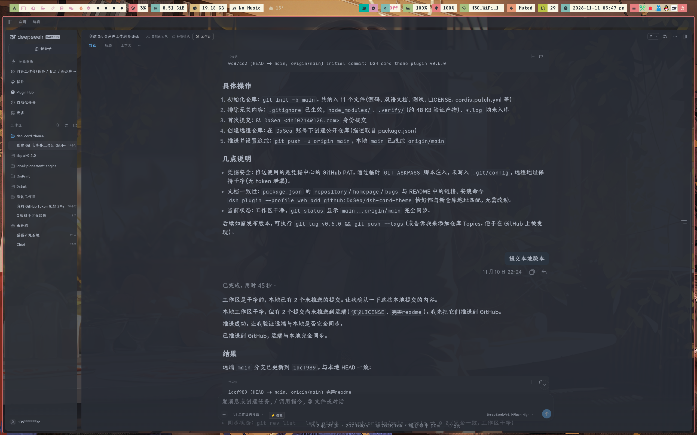

# dsh-card-theme

**[English](README.md) · [简体中文](README.zh-CN.md)**

Theme for the DeepSeek Harness (DSH) Web GUI, has features:
1. three built-in palettes — Nord, Solarized and One Dark — plus the stock DeepSeek theme, and fully customizable light/dark palettes;
2. accent, background, foreground, translucent sidebar, contrast and a wallpaper background image;
3. plus an optional card layout for the three shell columns;
4. a conversation content column width;



## Features

- 🎨 **3 built-in palettes** — `nord`, `solarized` and `onedark` (One Dark for dark mode, One Light for light mode), plus the stock DeepSeek theme `stock`; `custom` config mode reuses the Nord base palette
- 🖌️ **Full customization** — accent, background, foreground, translucent sidebar, contrast and background image, configurable per mode (`light.*` / `dark.*`); studio pickers write one value for both modes
- 🖼️ **Background image** — pick a local file or paste a URL, then tune the theme-color mask, blur, fit (`cover` / `contain` / `auto`) and alignment; the palette turns translucent so the wallpaper shows through the app chrome
- 🃏 **Optional card layout** — turn the left sidebar, the center column and the right panel into rounded cards separated by a canvas gap; toggle it in Theme Studio or with `cardLayout: true` (fonts stay with the platform's own Appearance settings — the plugin does not configure them)
- 📐 **Content column width** — set the conversation content column's target width (400–2400 px, quick chips 640/748/920/1200, or the platform-automatic default); the leftover space becomes gutters. Implemented through the platform's own `--dsh-chat-user-width` variable, so native edge-drag handles keep working and win locally. Configure in Theme Studio or with `centerContentWidth`
- ⚡ **Instant hot-swap** — a Settings GUI ("Theme Studio") applies changes immediately through the official `ctx.theme.overrideTokens` API; light/dark follow the system preference
- 💾 **Persistent** — the selection is saved in browser `localStorage` and survives reloads
- 🧮 **100+ derived tokens** — three colors plus a contrast value expand into the current semantic token set: borders, layers, scrollbar, tooltip, code blocks, bubbles, sidebar states, settings cards, illustrations, onboarding surfaces…
- 🪟 **Translucent sidebar** — real frosted sidebar via the `--dsw-specific-sidebar-fill` variable
- 🔌 **Official seams only** — `webserver/index-inject` rows carry the first-paint stylesheet and the host config to both the HTTP index and the desktop boot payload (`webServer.tapIndex` fallback on older shells); `ctx.theme.overrideTokens` carries the live tokens; no patched vendor files

## Installation

Requires DeepSeek Harness **0.2.2-rc.1** (installed and tested; 0.2.1-rc.2 and newer 0.2.x releases are supported) and a web-serving profile — `web` for `dsh web`, `desktop` for the desktop app. Install from the official registry (`--profile` names the profile that serves the GUI):

```sh
# browser build (dsh web):
dsh plugin --profile web add github:DaSea/dsh-card-theme
```

The desktop `desktop` profile belongs to the Electron application, so the `dsh plugin` CLI refuses it. In the desktop app use **Settings → Plugins → Install** instead, and paste the GitHub address or the absolute path of a local checkout.

For a local checkout, run `pnpm install` in the plugin directory first: a `link:` install does not install the plugin's own dependencies (it needs `@deepseek-ai/schemastery`).

Restart the profile (or the desktop app) for the plugin to take effect.

To remove:

```sh
dsh plugin --profile web remove dsh-card-theme
```

## Usage

### Settings GUI (recommended)

After a restart, open **Settings → Theme Studio**:

- **Preset** — one-click chips: DeepSeek default / Nord / Solarized / One Dark
- **Colors** — color pickers for accent, background and foreground, with a "follow preset" reset
- **Card layout** — off / on; the left, center and right columns become rounded cards over a canvas gap
- **Content width** — slider 400–2400 px plus 跟随默认 / 640 / 748 / 920 / 1200 presets; sets the conversation content column's width (gutters excluded)
- **Translucent sidebar** — follow preset / on / off
- **Background image** — choose a local file (compressed automatically) or paste an image URL, then adjust the mask (0–100%), blur (0–60 px), fit and alignment; clear it to return to a plain surface
- **Contrast** — slider 0–100 with preset restore

Every change applies instantly and persists locally; GUI selections take priority over host config.

> The `stock` preset derives no palette: color controls are disabled and only the background image (and the global card layout) can be overridden.

### Config reference

| Field | Type | Description |
|---|---|---|
| `preset` | enum | `stock` · `nord` · `solarized` · `onedark` · `custom` (default `nord`) |
| `cardLayout` | boolean | card layout for the three shell columns (default `false`); also toggleable in Theme Studio |
| `centerContentWidth` | number | conversation content column width in px, clamped 400–2400; `-1` = follow the platform default (680–920 px responsive; default) |
| `light.accent` | color | accent for light mode (primary buttons, links, …) |
| `light.background` | color | light-mode background |
| `light.foreground` | color | light-mode primary text |
| `light.translucentSidebar` | enum | `preset` · `on` · `off` |
| `light.contrast` | number | 0–100; `-1` = keep preset value |
| `light.backgroundImage` | string | image URL or `data:` URI; empty = no image |
| `light.backgroundImageMask` | number | 0–100 theme-color coverage over the image; `-1` = 70 |
| `light.backgroundImageBlur` | number | 0–60 px blur; `-1` = 0 |
| `light.backgroundImageSize` | enum | `cover` · `contain` · `auto` (default `cover`) |
| `light.backgroundImagePosition` | string | CSS `background-position` (default `center`) |
| `dark.*` | — | same fields for dark mode |

Empty strings mean "keep the preset value"; unset fields are not overridden at all.

On DSH 0.2.x the web-shell creates client entries without config (`create(loader, id)` passes `{ name }` only), so `client.js` no longer receives this block from Cordis. The host half publishes the config through the structured index-injection seam as `globalThis.__DSH_THEME_PLUGIN_CONFIG__`, and the client half reads it as the initial selection. (Older shells get the same payload as a `#dsh-card-theme-config` JSON block in `index.html`.) A selection saved by Theme Studio (`localStorage`) wins; host config is deliberately not written to `localStorage`, so later config edits still apply on reload until you touch the studio.

Example — merge into the serving profile's patch (`$DSH_HOME/profiles/<profile>/cordis.patch.yml`):

```yaml
- id: card-theme-plugin
  config:
    preset: nord
    cardLayout: true
    centerContentWidth: 960
    light:
      accent: '#FF6B35'
      background: '#FFFAF0'
      foreground: '#1A1A1A'
      translucentSidebar: off
      contrast: 70
      backgroundImage: 'https://example.com/light.jpg'
      backgroundImageMask: 72
      backgroundImageBlur: 2
      backgroundImageSize: cover
      backgroundImagePosition: center
    dark:
      accent: '#FFB07A'
      background: '#1A1A1A'
      foreground: '#F5F5F5'
      translucentSidebar: on
      contrast: 70
      backgroundImage: 'https://example.com/dark.jpg'
      backgroundImageMask: 80
      backgroundImageSize: cover
      backgroundImagePosition: center bottom
```

Only set the fields you want to change; leave the rest blank (`''` / `preset` / `-1`).

### Presets

| Preset | Style | Light bg / fg / accent | Dark bg / fg / accent |
|---|---|---|---|
| `stock` | DeepSeek default | — (no override) | — (no override) |
| `nord` | Nord cool | `#ECEFF4` / `#2E3440` / `#5E81AC` | `#2E3440` / `#ECEFF4` / `#88C0D0` |
| `solarized` | Solarized | `#FDF6E3` / `#657B83` / `#B58900` | `#002B36` / `#839496` / `#268BD2` |
| `onedark` | One Dark (One Light in light mode) | `#FAFAFA` / `#383A42` / `#4078F2` | `#282C34` / `#ABB2BF` / `#61AFEF` |

`custom` uses the `nord` palette as its fallback base and takes every value from `light.*` / `dark.*`.

> **Upgrading from 0.2.x:** the `codex-warm` and `graphite` presets were removed in 0.3.0. Their ids are still accepted as deprecated aliases (in `localStorage` selections and host config) and resolve to `nord`; pick a current preset in the studio to migrate the saved selection.

## How it works

- **Host half** (`index.js`) — registers a `webserver/index-inject` listener and pushes two structured rows per index render: a `style` row with the first-paint token stylesheet, and a `global` row carrying the host config as `globalThis.__DSH_THEME_PLUGIN_CONFIG__`. This seam feeds both the HTTP-served `index.html` (via `renderIndex`) and the desktop boot payload (the Electron renderer receives only the row table and never runs `tapIndex`). Shells without the row seam fall back to `webServer.tapIndex`, which injects the stylesheet and the `#dsh-card-theme-config` JSON block before `</head>`.
- **Live tokens** — since 0.2.x the official theme presenter writes every active token as an inline style on `<body>`, so the injected stylesheet only covers the first paint before the client bundle mounts. The steady-state palette comes from the **client half** (`client.js`), which registers the "Theme Studio" Settings section and writes each change through `ctx.theme.overrideTokens`.
- **Config path** — the client half reads `globalThis.__DSH_THEME_PLUGIN_CONFIG__` (falling back to the `#dsh-card-theme-config` DOM block) because 0.2.x no longer passes Cordis config to client plugins. A studio edit is saved to `localStorage` and takes over; a config-only setup is re-read on every reload.
- **Token derivation** — from background / foreground / accent plus a contrast factor, a small functional engine derives 100+ semantic tokens: border levels, layers, scrollbar, tooltip, markdown code blocks, bubbles, sidebar states, plus the 0.2.2 surfaces (settings cards, illustrations, menu group headers, onboarding cards, turn triggers, switch thumb, toolbar fills, toast label). Status and diff colors (success / error / warn / file diffs) keep their stock meaning.
- **Translucent sidebar** — `--dsw-specific-sidebar-fill` is emitted as `rgba(mix(bg, fg, 3%), 0.65)` when enabled; AppFrame / SidebarRoot / WorkspaceBrowser / TrajectoryTable consume that variable directly.
- **Wallpaper** — the image is painted on a fixed `body::before` layer (`z-index: -1`, above the page canvas and below the app content). With an image active, `--dsw-alias-bg-base` and `--dsw-specific-sidebar-fill` become translucent by the mask percentage, so the wallpaper is visible through the app surfaces; blur uses a negative-inset layer to avoid soft edges.
- **Card layout** — the stylesheet is attribute-gated (`html[data-dsh-card-theme]`) and targets the shell structurally: the frame is the element owning `[data-rightbar-col]` and `[data-shell-bottom]`, the left card is its `[class*="sidebarCol"]` child, the center card is the child followed by the rightbar track, and the right panel is `[data-sidebar-right-panel="push"]`. Card geometry and colors arrive as five `--dsh-theme-*` custom properties, so they follow the active palette and background image. The host half also emits a tiny boot script that applies the attribute from the host config or a saved studio selection before first paint, and the client half toggles the attribute live.
- **Content width** — the platform's conversation view already sizes its content column from `--dsh-chat-content-width: var(--dsh-chat-user-width, clamp(680px, …, 920px))`. The plugin simply publishes `--dsh-chat-user-width: <N>px` on `<html>`: the boot script does it before first paint (host config or saved studio selection), the client half keeps it in sync live, and `-1` removes the property to fall back to the automatic width. Because the native width handles write the same variable inline on the conversation body (a closer element), manual dragging still overrides the global value locally.
- **Specificity** — the injected selectors are written as `html body` / `html body[data-ds-dark-theme]` (and `::before` for the wallpaper); the client half writes `{ light, dark }` pairs and lets the theme runtime pick the active mode.

## Compatibility

- DeepSeek Harness Web GUI, **0.2.2-rc.1** (installed and tested); `engines.dsh: >=0.2.1-rc.2 <0.3.0-0`
- Node.js >= 22.19
- Peer dependencies: `@deepseek-ai/cordis` (^4.0.5 / ^4.0.6-alpha.1), `@deepseek-ai/dsh-host-webserver` (^0.2.1-rc.2 / ^0.2.2-alpha.2)
- Older 0.1.0-rc.x releases are not supported by this version (the client entry/config ABI changed in 0.2.x)

## Development

```sh
pnpm install
pnpm test   # host-half checks, client-half VM harness, host/client parity
```

The test suite is plain Node (no test framework): `test/host-check.mjs` exercises the schema, the derived tokens and the `webserver/index-inject` rows; `test/client-check.mjs` loads `client.js` in a `node:vm` sandbox with fake browser/React shims and drives the Theme Studio; `test/parity-check.mjs` fails if the presets, the token engine or the card-layout stylesheet in the two halves drift apart.

## License

MIT © DaSea

## Thanks

- Repository: <https://github.com/BeiZi6/dsh-theme-plugin>

