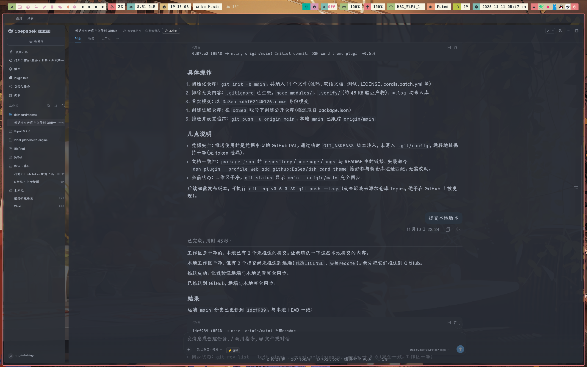

# dsh-theme-card

**[简体中文](README.zh-CN.md) · [English](README.md)**

DSH Desktop主题，主要包含以下内容:
1. 3 套内置配色 —— Nord、Solarized、One Dark —— 外加 DeepSeek 默认主题,并支持完全自定义的浅色/深色调色板;
2. 强调色、背景、前景、半透明侧边栏、对比度与背景图片;
3. 左中右三栏可选的卡片布局;
4. 内容列宽度设定;



## 特性

- 🎨 **3 套内置配色** —— `nord`、`solarized`、`onedark`(深色模式为 One Dark,浅色模式为 One Light),外加 DeepSeek 默认主题 `stock`;`custom` 配置模式以 Nord 为底色起点
- 🖌️ **完全自定义** —— 强调色、背景、前景、半透明侧边栏、对比度与背景图片,可按模式(`light.*` / `dark.*`)分别配置;设置页的取色器对明暗两种模式写入同一个值
- 🖼️ **背景图片** —— 选择本地文件或粘贴图片 URL,再调整主题色遮罩、模糊、填充方式(`cover` / `contain` / `auto`)与对齐;调色板会按遮罩变为半透明,让壁纸透过应用界面显示
- 🃏 **可选卡片布局** —— 左栏、中栏、右栏各自变成圆角卡片,卡片之间露出画布间隙;可在「主题工作室」开关,或在配置里写 `cardLayout: true`。(字体交给平台自带的「外观」设置,插件不再配置字体。)
- 📐 **内容区域宽度** —— 设定中间对话内容列的目标宽度(400–2400 px,快捷档 640/748/920/1200,或「跟随默认」),多余空间自动成为两侧留白;通过平台自身的 `--dsh-chat-user-width` 变量实现,对话区左右边缘的原生拖拽依然可用且本地优先。在「主题工作室」调节,或配置 `centerContentWidth`
- ⚡ **即时热切换** —— 设置页「主题工作室」通过官方 `ctx.theme.overrideTokens` API 立即应用改动;浅色/深色自动跟随系统明暗偏好
- 💾 **持久化** —— 选择保存在浏览器 `localStorage` 中,刷新后保持
- 🪟 **半透明侧边栏** —— 通过 `--dsw-specific-sidebar-fill` 变量实现真正的毛玻璃侧边栏
- 🔌 **仅使用官方接缝** —— `webserver/index-inject` 结构化行把首屏样式与宿主配置同时送到 HTTP index 和桌面端启动载荷(旧版回退 `webServer.tapIndex`);`ctx.theme.overrideTokens` 负责实时令牌,不修改任何供应商文件

## 安装

需要 DeepSeek Harness **0.2.2-rc.1**(已安装并测试;0.2.1-rc.2 及更新的 0.2.x 版本均支持),以及一个提供 Web 服务的 profile——浏览器版为 `web`,桌面端为 `desktop`。从官方 registry 安装(`--profile` 指定提供 GUI 的 profile):

```sh
# 浏览器版(dsh web):
dsh plugin --profile web add github:DaSea/dsh-theme-card
```

桌面端的 `desktop` profile 由 Electron 应用独占,`dsh plugin` CLI 会拒绝该 profile。请在桌面应用内使用 **设置 → 插件 → 安装**,填入 GitHub 地址或本地目录的绝对路径。

本地目录安装前,先在插件目录执行 `pnpm install`:以 `link:` 方式安装不会代装插件自身的依赖(需要 `@deepseek-ai/schemastery`)。

重启对应 profile(或桌面端)后生效。

卸载:

```sh
dsh plugin --profile web remove dsh-theme-card
```

## 使用

### 设置页 GUI(推荐)

重启后打开 **设置 → 主题工作室**:

- **预设** —— 一键切换:DeepSeek 默认 / Nord / Solarized / One Dark
- **颜色** —— 强调色、背景、前景的颜色选择器,支持「跟随预设」复位
- **卡片布局** —— 关闭 / 开启;左、中、右三栏变为浮在画布上的圆角卡片
- **内容区域宽度** —— 滑条 400–2400 px,外加 跟随默认 / 640 / 748 / 920 / 1200 快捷档;设定对话内容列宽度(不含两侧留白)
- **半透明侧边栏** —— 跟随预设 / 开启 / 关闭
- **背景图片** —— 选择本地文件(会自动压缩)或粘贴图片 URL,再调整遮罩(0–100%)、模糊(0–60 px)、填充与对齐;清除后恢复纯色表面
- **对比度** —— 0–100 滑条,可恢复预设值

所有改动立即生效并本地持久化;GUI 中的选择优先于 Host 配置。

> `stock` 预设不派生调色板:颜色控件禁用,仅背景图片(以及全局的卡片布局)可覆盖。

### 配置字段

| 字段 | 类型 | 说明 |
|---|---|---|
| `preset` | 枚举 | `stock` · `nord` · `solarized` · `onedark` · `custom`(默认 `nord`) |
| `cardLayout` | 布尔 | 三栏卡片布局(默认 `false`);也可在「主题工作室」里切换 |
| `centerContentWidth` | 数字 | 对话内容列宽度(px),钳制在 400–2400;`-1` = 跟随平台默认(680–920 px 自适应;默认值) |
| `light.accent` | 颜色 | 浅色模式强调色(主按钮、链接等) |
| `light.background` | 颜色 | 浅色背景 |
| `light.foreground` | 颜色 | 浅色主文字 |
| `light.translucentSidebar` | 枚举 | `preset` · `on` · `off` |
| `light.contrast` | 数字 | 0–100;`-1` = 保持预设值 |
| `light.backgroundImage` | 字符串 | 图片 URL 或 `data:` URI;空 = 不启用 |
| `light.backgroundImageMask` | 数字 | 0–100,主题色覆盖图片的比例(越大越易读);`-1` = 70 |
| `light.backgroundImageBlur` | 数字 | 0–60 px 模糊;`-1` = 0 |
| `light.backgroundImageSize` | 枚举 | `cover` · `contain` · `auto`(默认 `cover`) |
| `light.backgroundImagePosition` | 字符串 | CSS `background-position`(默认 `center`) |
| `dark.*` | — | 深色模式的同名字段 |

空字符串表示「使用预设值」;未设置的字段完全不覆盖。

DSH 0.2.x 的 web-shell 创建 client 入口时不再传配置(`create(loader, id)` 只带 `{ name }`),因此 `client.js` 收不到这段 Cordis 配置。Host 半端改为通过官方 index 注入接缝发布 `globalThis.__DSH_THEME_PLUGIN_CONFIG__`,client 半端读取它作为初始选择。(旧版 shell 仍会拿到 `index.html` 中的 `#dsh-theme-card-config` JSON 块。)设置页保存过的选择(`localStorage`)优先;Host 配置不会被主动写入 `localStorage`,所以之后修改配置在刷新后仍然生效,直到你在设置页里改动过一次。

示例——合并进提供服务的 profile patch(`$DSH_HOME/profiles/<profile>/cordis.patch.yml`):

```yaml
- id: card-theme-plugin
  config:
    preset: nord
    cardLayout: true
    centerContentWidth: 960
    light:
      accent: '#FF6B35'
      background: '#FFFAF0'
      foreground: '#1A1A1A'
      translucentSidebar: off
      contrast: 70
      backgroundImage: 'https://example.com/light.jpg'
      backgroundImageMask: 72
      backgroundImageBlur: 2
      backgroundImageSize: cover
      backgroundImagePosition: center
    dark:
      accent: '#FFB07A'
      background: '#1A1A1A'
      foreground: '#F5F5F5'
      translucentSidebar: on
      contrast: 70
      backgroundImage: 'https://example.com/dark.jpg'
      backgroundImageMask: 80
      backgroundImageSize: cover
      backgroundImagePosition: center bottom
```

只设置想改的字段,其余留空(`''` / `preset` / `-1`)。

### 预设

| 预设 | 风格 | 浅色 背景 / 前景 / 强调 | 深色 背景 / 前景 / 强调 |
|---|---|---|---|
| `stock` | DeepSeek 默认 | —(不覆盖) | —(不覆盖) |
| `nord` | Nord 冷色 | `#ECEFF4` / `#2E3440` / `#5E81AC` | `#2E3440` / `#ECEFF4` / `#88C0D0` |
| `solarized` | Solarized | `#FDF6E3` / `#657B83` / `#B58900` | `#002B36` / `#839496` / `#268BD2` |
| `onedark` | One Dark(浅色为 One Light) | `#FAFAFA` / `#383A42` / `#4078F2` | `#282C34` / `#ABB2BF` / `#61AFEF` |

`custom` 以 `nord` 调色板作为回退底色,所有值取自 `light.*` / `dark.*`。

> **从 0.2.x 升级:** 0.3.0 移除了 `codex-warm` 与 `graphite` 预设。这两个 id 仍作为过时别名被接受(`localStorage` 选择与 Host 配置都能通过校验),并回退到 `nord`;在设置页里重新选一次当前预设即可完成迁移。

## 工作原理

- **Host 半端**(`index.js`) —— 注册 `webserver/index-inject` 监听器,每次渲染 index 时压入两类结构化行:携带首屏令牌样式表的 `style` 行,以及把宿主配置发布为 `globalThis.__DSH_THEME_PLUGIN_CONFIG__` 的 `global` 行。该接缝同时服务于 HTTP 响应的 `index.html`(`renderIndex`)和桌面端启动载荷(Electron 渲染器只接收行表,从不执行 `tapIndex`)。不支持行接缝的旧版 shell 回退到 `webServer.tapIndex`,在 `</head>` 前注入样式表与 `#dsh-theme-card-config` JSON 块。
- **实时令牌** —— 0.2.x 起官方主题呈现器会把当前主题的全部令牌以内联样式写到 `<body>` 上,注入的样式表只覆盖 client bundle 挂载前的首屏;稳定状态下的配色来自 **Client 半端**(`client.js`):它注册设置页「主题工作室」,每次改动通过 `ctx.theme.overrideTokens` 写入。
- **配置链路** —— Client 半端优先读取 `globalThis.__DSH_THEME_PLUGIN_CONFIG__`,其次回退到 `#dsh-theme-card-config` DOM 块(0.2.x 不再把 Cordis 配置传给 client 插件)。在设置页改动后选择写入 `localStorage` 并接管;纯配置方式每次刷新都会重新读取。
- **令牌推导** —— 由背景 / 前景 / 强调三色加对比度因子,函数式推导 100+ 语义令牌:边框层级、层级背景、滚动条、提示框、markdown 代码块、气泡、侧边栏状态,以及 0.2.2 新增的设置卡片、插画、菜单分组头、引导页卡片、输入触发条、开关滑块、工具栏填充与 toast 文案色等表面。状态色与 diff 色(success / error / warn / 文件差异)保持 stock 语义不变。
- **半透明侧边栏** —— 开启时 `--dsw-specific-sidebar-fill` 输出为 `rgba(mix(bg, fg, 3%), 0.65)`;AppFrame / SidebarRoot / WorkspaceBrowser / TrajectoryTable 直接消费该变量。
- **背景图片** —— 图片绘制在固定的 `body::before` 图层(`z-index: -1`,位于页面画布之上、应用内容之下)。启用图片时,`--dsw-alias-bg-base` 与 `--dsw-specific-sidebar-fill` 按遮罩百分比变为半透明,壁纸便从应用表面透出;模糊通过负 inset 的外扩图层实现,避免边缘发虚。
- **卡片布局** —— 样式表由 `html[data-dsh-theme-cards]` 属性门控,并通过结构选择器定位页面框架:同时拥有 `[data-rightbar-col]` 与 `[data-shell-bottom]` 的元素是框架,其 `[class*="sidebarCol"]` 子元素是左卡片,紧跟右栏轨道之前的子元素是中卡片,右侧面板则是 `[data-sidebar-right-panel="push"]`。卡片间距、圆角与配色通过 5 个 `--dsh-theme-*` 自定义属性下发,因此会跟随当前配色与背景图片。Host 半端还会输出一小段启动脚本,在首屏前根据宿主配置或已保存的设置页选择设置该属性;Client 半端负责实时切换。
- **内容区域宽度** —— 平台对话视图本来就用 `--dsh-chat-content-width: var(--dsh-chat-user-width, clamp(680px, …, 920px))` 给内容列定宽。插件要做的只是把 `--dsh-chat-user-width: <N>px` 发布到 `<html>` 上:启动脚本在首屏前按宿主配置或已保存的选择写入,Client 半端负责实时同步,`-1` 则移除该变量回到自适应宽度。原生拖拽把手把同名变量写得更贴近元素(conversation body),所以手动调整仍然局部覆盖全局值。
- **选择器特异性** —— 注入样式使用 `html body` / `html body[data-ds-dark-theme]`(背景图片另用 `::before`);client 半端写入 `{ light, dark }` 令牌对,由主题运行时按当前明暗模式选用。

## 兼容性

- DeepSeek Harness Web GUI,**0.2.2-rc.1**(已安装并测试);`engines.dsh: >=0.2.1-rc.2 <0.3.0-0`
- Node.js >= 22.19
- Peer 依赖:`@deepseek-ai/cordis`(^4.0.5 / ^4.0.6-alpha.1)、`@deepseek-ai/dsh-host-webserver`(^0.2.1-rc.2 / ^0.2.2-alpha.2)
- 不再支持旧的 0.1.0-rc.x(client 入口/配置 ABI 在 0.2.x 已变化)

## 开发

```sh
pnpm install
pnpm test   # Host 半端检查 + Client 半端 VM 沙箱 + 两半端一致性
```

测试不依赖测试框架:`test/host-check.mjs` 校验 schema、派生令牌与 `webserver/index-inject` 行;`test/client-check.mjs` 在 `node:vm` 沙箱中加载 `client.js`,用假的浏览器/React 环境驱动「主题工作室」;`test/parity-check.mjs` 在两半端的预设、令牌引擎或卡片样式表漂移时失败。

## 许可证

MIT © DaSea

## 感谢

- 仓库: <https://github.com/BeiZi6/dsh-theme-plugin>

